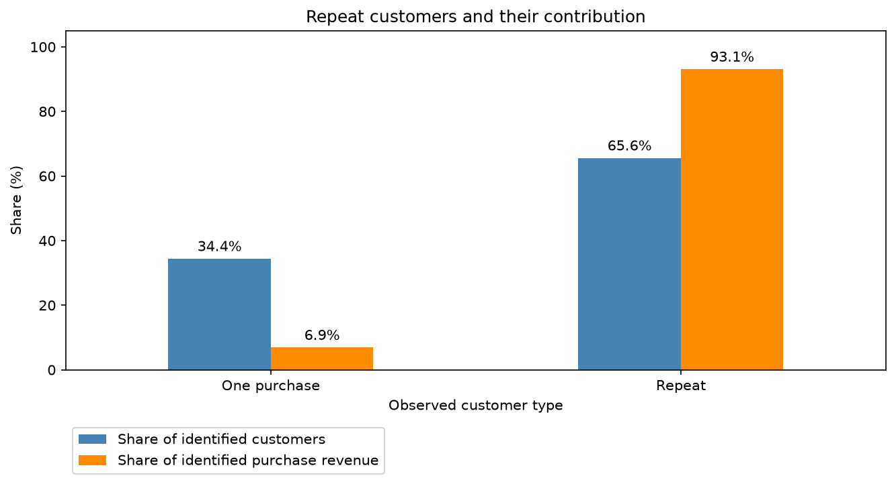
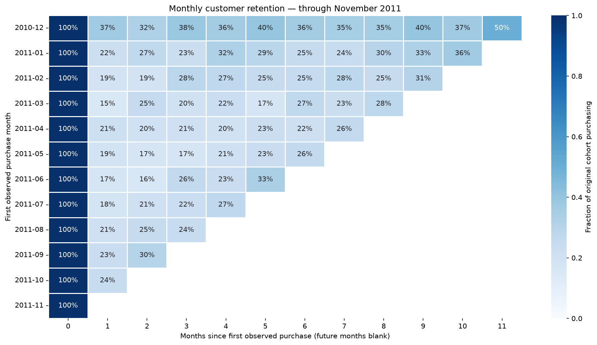
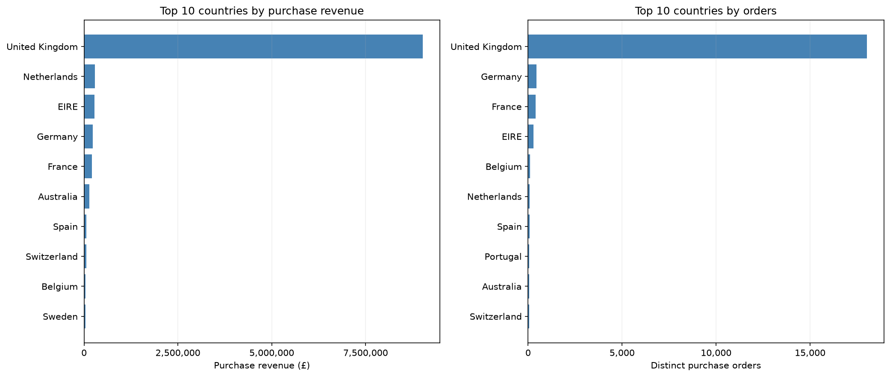
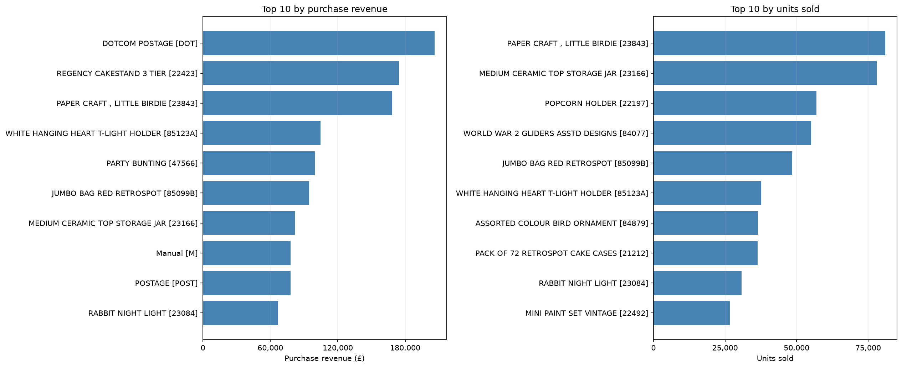
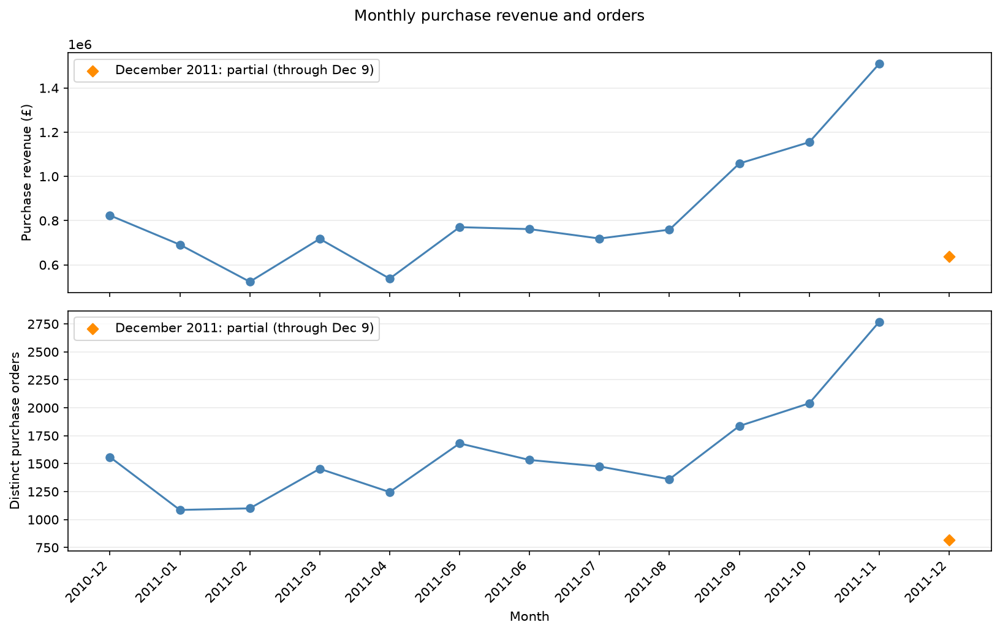

# Retail Sales and Customer Analysis

An end-to-end Python and SQLite analysis of UCI Online Retail, covering data quality, purchase sales, product and country concentration, repeat customers, and monthly cohort retention.

## Read the submission

- **REPORT.html**: standalone findings report with embedded charts; open in any browser.
- **retail_analysis.html**: full executed notebook with code, tables, charts, and validation output.
- **notebooks/retail_analysis.ipynb**: editable notebook with all saved outputs.
- **sql/analysis.sql**: SQL queries used in the analysis.
- **results/**: exported analysis tables, including cohort sizes and retention.
- **images/**: five chart PNGs.
- **data_audit.md**: source quality audit and cleaning decisions.

The submission ZIP excludes the local virtual environment, raw workbook, and generated line-level CSV/database. They can be recreated using the steps below. No dashboard is needed for the completed analysis.

## Reproduce in VS Code

Tested with Python 3.14 on macOS using the versions in `requirements.txt`. Python's built-in sqlite3 module is used; no database server is needed.

1. Download and extract [UCI Online Retail](https://archive.ics.uci.edu/dataset/352/online+retail). Place `Online Retail.xlsx` in `data/raw/`.
2. Open this folder or `retail-sales-analysis.code-workspace` in VS Code. Install the recommended Python and Jupyter extensions.
3. Create the environment and install dependencies:

```sh
python3 -m venv .venv
source .venv/bin/activate
python -m pip install -r requirements.txt
```

4. Open `notebooks/retail_analysis.ipynb` and select `.venv/bin/python` as its kernel. Run all cells from top to bottom.
5. The notebook creates `data/processed/sales.csv`, `data/processed/retail.db`, tables in `results/`, charts in `images/`, and `REPORT.md`. Rerunning replaces generated outputs. The supplied HTML files are snapshots of the verified final execution.

On Windows, create the environment with `python -m venv .venv`, activate it with `.venv\Scripts\Activate.ps1`, and select `.venv\Scripts\python.exe` as the kernel. The frozen environment was validated on macOS; platform-specific dependencies may need adjustment.

## Data and metric definitions

Each source row is an invoice line, not an order. Purchase sales require positive quantities and prices and exclude cancellation invoices beginning with C. Customer IDs are preserved as identifiers; missing IDs remain in overall sales and are excluded from customer metrics. Exact duplicate lines are retained and their revenue impact is reported as a sensitivity check.

Orders count distinct InvoiceNo values. Average order value is purchase revenue divided by distinct orders. Product totals group by StockCode, with a representative description. Country shares use all purchase revenue. A repeat customer has two or more distinct purchase invoices in the observation window. Repeat-customer revenue shares use identified purchase revenue as the denominator.

Cohorts use first observed purchase month and original cohort size. The retention analysis ends in November 2011 to exclude partial December 2011. Observed inactivity is zero; future unobserved months are blank. Purchase revenue is not net revenue and does not measure profit.

## Validation

The notebook passed a complete execution. Checks reconcile SQL and pandas revenue, monthly/product/country totals and units, customer denominators, retention bounds and future-month masks, and arithmetic for three displayed invoices. December 2011 is explicitly labelled partial. Cancellation values and duplicate sensitivity are reported separately.

# Findings and recommendations

**Business question:** What drives this store's revenue, and how important are repeat customers?

## Results at a glance

- Purchase revenue: **£10,666,684.54**, across **19,960** distinct purchase invoices.
- Average order value: **£534.40**.
- Positive purchase lines: **530,104**; identified purchasing customers: **4,338**.
- Identified customer coverage: **83.5%** of purchase revenue.
- These are positive purchase sales, **not net revenue or profit**. Currency is GBP.

## 1. Repeat customers account for most identified purchase revenue

**Finding:** Repeat customers are **65.6%** of identified purchasing customers and generate **93.1%** of identified purchase revenue (77.8% of all purchase revenue). Across cohorts with month 1 observable through November 2011, **23.7%** of original cohort members purchase in the next calendar month. For the first observed cohort (2010-12), this figure is 36.6%.

**Interpretation:** Returning purchasers contribute a large share of the observed sales. Monthly retention measures purchasing in a calendar month, so a customer who skips month 1 may still return later.

**Recommendation:** Test a targeted retention campaign with a holdout group and measure incremental repeat orders and contribution margin after campaign costs.

**Limitation:** Missing IDs leave 16.5% of purchase revenue outside customer analysis. Repeat status is measured across the whole observation window and is affected by unequal follow-up. First observed purchases may belong to existing customers; the analysis does not prove that a campaign would increase sales.




## 2. Purchase revenue is concentrated in the leading country

**Finding:** **United Kingdom** contributes **84.6%** of purchase revenue (£9,025,222.08). The ten leading product codes contribute **10.8%** of purchase revenue.

**Interpretation:** Observed demand is geographically concentrated, while product rankings identify codes worth reviewing for availability and merchandising.

**Recommendation:** Prioritize service and stock availability for the leading market, then assess smaller markets using shipping costs, margins, and customer demand. Review top product codes for service or postage entries before making inventory decisions.

**Limitation:** Customer country is not necessarily delivery country. Revenue is not profit, and this retailer's customers do not represent the entire market. Wholesale purchases and retained duplicate lines can influence rankings.




## 3. The largest comparable month is late in the observation window

**Finding:** Excluding partial December 2011, **2011-11** has the highest purchase revenue at **£1,509,496.33**, **98.8%** above August 2011.

**Interpretation:** The pattern is consistent with a late-year demand increase, but the dataset cannot separate seasonal effects from growth, promotions, or large individual orders.

**Recommendation:** Investigate product and order mix during the peak and use that evidence to test inventory and staffing plans ahead of similar periods.

**Limitation:** December 2011 ends on December 9 and is not comparable with a full month. One observation window is insufficient to establish recurring annual seasonality. December 2010 has no transactions after December 23; absence of activity alone does not prove missing data.



## Data treatment and limitations

- Positive quantities and unit prices; cancellation invoices excluded from purchase sales. Raw workbook preserved.
- Rows without customer IDs remain in overall sales and are excluded from customer metrics.
- Exact duplicates retained pending evidence. Removing identical purchase lines would reduce purchase revenue by **£24,573.74 (0.23%)**.
- Cancellation review: **9,288 lines**, with a signed line value of **£-896,812.49**. This is not a validated refund or net-revenue adjustment.
- Product grouping uses StockCode and its most frequent nonblank description for display.
- Cohort retention excludes partial December 2011, uses original cohort size as the denominator, records observed inactivity as zero, and leaves future months blank.
- Checks reconcile SQL/pandas revenue, monthly/product/country totals, customer denominators, and three invoice arithmetic examples. All checks passed in this execution.

## Source

Chen, D. (2015). *Online Retail*. UCI Machine Learning Repository. [Dataset and documentation](https://archive.ics.uci.edu/dataset/352/online+retail). DOI: [10.24432/C5BW33](https://doi.org/10.24432/C5BW33). Licensed under CC BY 4.0. Transaction prices are in sterling.
